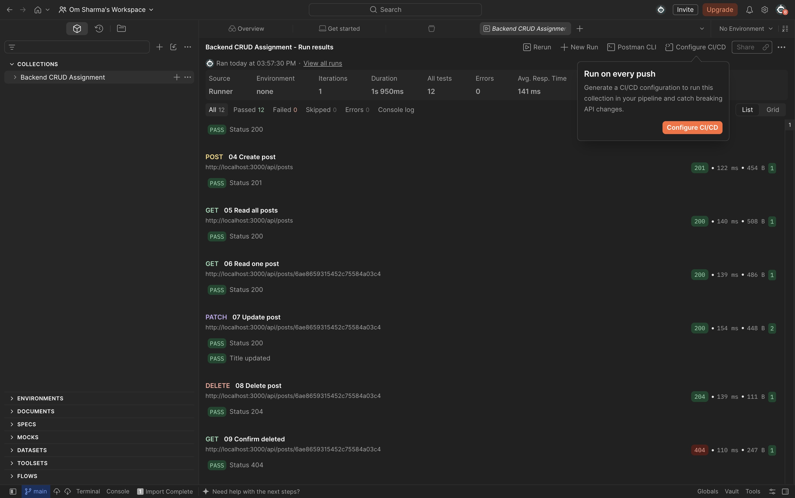

# Backend CRUD Assignment

Node.js + Express + MongoDB backend inspired by [Shivani's freeCodeCamp tutorial](https://www.youtube.com/watch?v=KOutPbKc9UM). This is an independent implementation of the course topics, with validation, session authentication, author permissions and integration tests added.

## Run locally

Requires Node.js 22+ and a MongoDB Atlas cluster (or a local MongoDB server).

```sh
npm ci
cp .env.example .env
# Edit .env: set MONGODB_URI and a random SESSION_SECRET of at least 32 characters
npm run dev
```

Generate a session secret with `node -e "console.log(require('node:crypto').randomBytes(32).toString('hex'))"`. Keep it in `.env`; never commit database credentials. The API runs at http://localhost:3000. Use `npm start` without file watching.

## MongoDB Atlas setup

1. Sign up or sign in at https://cloud.mongodb.com/.
2. Create a project and a free cluster; verify the selected tier is free before deploying.
3. Create a database user with read/write access only to `backend_assignment`. Save its password privately.
4. Under Network Access, allow your current development IP. Update it if your IP changes.
5. Choose Connect → Drivers → Node.js and copy the connection string into your local `.env` as `MONGODB_URI`. Replace username/password placeholders, URL-encode special password characters, and use database name `backend_assignment`.
6. Start the app. MongoDB creates `users`, `posts`, and `sessions` collections when used. Run the Postman collection and inspect the persisted data in Atlas.

Official guide: https://www.mongodb.com/docs/get-started/

## API

| Method | Path | Purpose | Access |
| --- | --- | --- | --- |
| GET | /api/health | Health check | Public |
| POST | /api/users/register | Create user | Public |
| POST | /api/users/login | Start session | Public |
| POST | /api/users/logout | Destroy session | Logged in |
| POST | /api/posts | Create post | Logged in |
| GET | /api/posts?page=1&limit=20 | List posts | Public |
| GET | /api/posts/:id | Read one post | Public |
| PATCH | /api/posts/:id | Update title/content | Author |
| DELETE | /api/posts/:id | Delete post | Author |

Register/login JSON: `{"name":"Om","email":"om@example.test","password":"ExamplePass123!"}` (login only needs email/password).

Create JSON: `{"title":"My first post","content":"Learning Express and MongoDB"}`. Update accepts title and/or content. Delete returns 204 with no body. Invalid input returns 400, unauthenticated requests 401, wrong author 403, missing records 404, duplicate email 409.

Passwords are hashed with bcrypt. Login rotates the session ID; sessions persist in MongoDB. The HTTP-only cookie is named `sid`. Postman retains it automatically. Registration does not log you in. Logout invalidates the server session.

## Test with Postman desktop

1. Install Postman from https://www.postman.com/downloads/ and open the desktop app.
2. Import `postman/Backend.postman_collection.json`.
3. Start the server with your Atlas `.env`, then run the collection in order with its Collection Runner. Default `baseUrl` is `http://localhost:3000`.
4. It registers a unique test user, logs in, creates/reads/updates/deletes a post, verifies deletion, logs out, and verifies protected access is denied. Scripts automatically capture `postId`; leave cookies enabled.
5. The test user remains in your database, while the test post is deleted. Export results or take screenshots if your instructor requires proof of the desktop run.

You can run the same collection from the terminal with `npx newman run postman/Backend.postman_collection.json` while the API is running.

## Automated tests

```sh
npm test
```

Tests launch a temporary real MongoDB process using mongodb-memory-server (first run downloads the official MongoDB binary). They cover hashing, duplicate registration, invalid login/input, persistent sessions, all CRUD operations, author permissions, missing records, malformed JSON and logout. These tests do not create or verify an Atlas account or prove a Postman desktop run.

## Structure

- `src/index.js`: environment configuration, database connection, startup/shutdown
- `src/app.js`: Express middleware and error handling
- `src/config/`: MongoDB connection
- `src/models/`: Mongoose User and Post schemas
- `src/controllers/`: authentication and CRUD behavior
- `src/routes/`: HTTP endpoint definitions
- `src/middleware/`: session access checks
- `test/`: database-backed API tests
- `postman/`: importable requests and assertions

## Scope

This is a local learning assignment. Production deployment additionally needs HTTPS, deployment-specific proxy settings, rate limiting, and a deliberate CSRF policy. Set `NODE_ENV=production` only behind an appropriate HTTPS configuration because cookies then require HTTPS.

## Assignment checklist

- Node project, model/controller/route separation, user and post models: included.
- Register, login, logout and post CRUD endpoints: included.
- Postman collection and automated tests: included.
- Public GitHub repository: https://github.com/som62630/backend-crud-assignment
- Atlas cluster: active; application connection and the complete collection verified against `backend_assignment`.
- Postman collection: 11 requests and 12 assertions passed against Atlas using Newman. Postman desktop execution also passed: 12 assertions passed, 0 failed, 0 errors.


